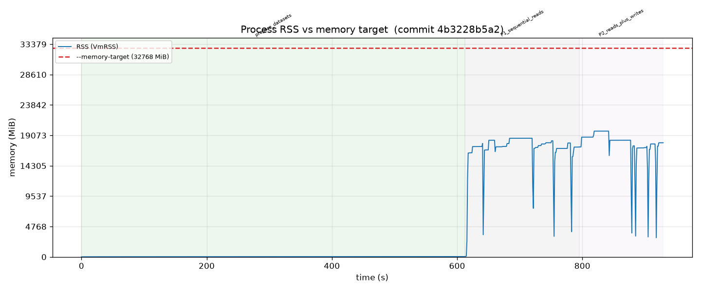

<!--
Top-level findings report for the memory-limiter stress test. Synthesises the
baseline (unconstrained) run and the full 1-hour constrained run. Per-run
auto-generated reports (with their own graphs) live under runs/<run>/REPORT.md;
this document is the human-facing summary.
-->

# Memory-limiter stress test — findings

## Question

Does the `feature/memory-limit` branch of mountpoint-s3 keep process memory
under the configured `--memory-target` under a sustained, varied,
real-filesystem workload — and if not, under what conditions does it fail?

## Method

A real `mount-s3` binary (release, commit `4b3228b`) was mounted
out-of-process against `s3://adpeace-mountpoint-perf-test/memlimit-test/` on
`mpc7gn` (64-core aarch64, 123 GiB RAM). Six workload phases — sequential
reads, reads+writes, random reads, slow (rate-limited) reads, readdir/metadata,
and all-at-once — were driven through the mount with `fio` and `dd`/`ls`
loops, each phase running 10 minutes for a total of 1 hour. Process RSS was
sampled every second from `/proc/<pid>/status` (independent of FUSE, so the
sampler survives a wedged mount); mountpoint's own `pool.bytes_in_use` and
`pool.allocated_bytes` gauges were read from its `--log-metrics` output.

The mount ran with `--max-threads 16` (FUSE worker threads) and 8 MiB read
and write part sizes. Per-phase workload concurrency is given in the table
below.

The limiter splits `--memory-target` into a data-buffer budget
(`mem_limit - max(mem_limit/8, 128 MiB)`) that hard-bounds the pool, plus an
overhead reserve for metadata/internal structures the pool does not track. The
end-to-end property under test is whether **total RSS** stays under
`--memory-target`.

The full harness is in this directory and is reproducible: a run is determined
by `config.env` plus the commit. See `README.md` and `PLAN.md`.

## Baseline: the workload genuinely exceeds the limit

To confirm the limiter is actually exercised, the same workload was first run
with an effectively unconstrained limit (`--memory-target 32768`). Peak RSS
reached **19,741 MiB (~19 GiB)** during sequential reads and reads+writes —
about **10x** the 2 GiB constrained target. Without the limiter, this workload
would consume ~19 GiB, so any run that stays near 2 GiB reflects the limiter
working, not a workload that simply never needed the memory.



The flat region before ~600s is dataset preparation; RSS climbs to ~19 GiB
once the read/write workload begins.

- Baseline run: `runs/20260805T173919Z-baseline-32768MiB/` (full `REPORT.md`,
  `rss.png`, `pool.png`).

## Constrained run (the test): `--memory-target 2048`

- Memory target: **2048 MiB**; derived data-buffer budget: **1792 MiB**.
- Duration: 1 hour (6 phases x 10 min).
- Full run: `runs/20260805T175535Z-full-2048MiB/`.

### Verdict

**The limiter does not hold RSS under `--memory-target` once writes are
active.** It holds cleanly for read-only workloads, but any phase that
includes uploads drives RSS 12-21% over the target, and that overshoot is
not reclaimed until write/read pressure is actively reduced. No deadlock or
stall occurred; the mount unmounted cleanly at the end.

### Results

- Peak RSS: **2471 MiB (121% of the 2048 MiB target)**, in P6 (all-at-once).
- Peak `pool.bytes_in_use`: **1800 MiB** (budget 1792 MiB) — a marginal 8 MiB
  (one part) over.
- Peak `pool.allocated_bytes`: **1792 MiB** (exactly at budget).
- RSS over target for **1777 of 3997 workload samples (44%)**.
- Stalls / deadlocks: **none**; clean unmount.

Per-phase concurrency and peak RSS (MiB):

| Phase | Concurrency | Peak RSS | Over target? |
|---|---|---|---|
| P1 sequential reads | 24 readers | 1866 | no |
| P2 reads + writes | 24 readers + 16 writers | 2312 | **yes (+13%)** |
| P3 random reads | 32 readers | 2348 | **yes (+15%)** |
| P4 slow reads | 24 readers @ 1 MB/s each | 2348 (entry); settled ~1600 | transiently |
| P5 readdir | 1 recursive `ls -R`/`stat` loop | 1709 (entry); settled ~600 | no |
| P6 all at once | 24 seq + 32 rand readers + 16 writers + readdir | **2471** | **yes (+21%)** |

(Mount FUSE workers: `--max-threads 16` throughout.)

**RSS vs the 2048 MiB target** — RSS is under target for pure reads (P1),
crosses it as soon as writes start (P2), stays elevated through P3, drops
under low-pressure phases (P4 slow reads, P5 readdir), and peaks in P6:


**Pool memory vs the 1792 MiB data-buffer budget** — `pool.bytes_in_use`
(green) hugs the budget line during read-heavy phases but essentially respects
it; the RSS overshoot above is memory the pool does not track:


The full per-phase table is in
`runs/20260805T175535Z-full-2048MiB/REPORT.md`.

### Interpretation

The two memory signals diverge, and the divergence is the finding:

1. **The pool budget is essentially respected.** `pool.bytes_in_use` tracked
   right at the 1792 MiB data-buffer budget during read-heavy phases and only
   ever exceeded it by 8 MiB (a single part). So the limiter's *tracked*
   accounting works as designed.

2. **Total RSS is not.** During read-only phases (P1) RSS sat ~180 MiB under
   the target. As soon as writes started (P2) RSS rose past 2048 MiB and
   climbed steadily to ~2310 MiB, and the all-workloads phase (P6) reached
   2471 MiB. The gap between RSS and the pool gauge is memory the pool does
   not govern — upload-path buffers/structures, CRT, metadata, and allocator
   retention. The limiter's fixed overhead reserve
   (`max(mem_limit/8, 128 MiB)` = 256 MiB at this target) is not enough to
   cover it under write load.

3. **The overshoot is sticky.** After P2's writes ended, RSS did *not* fall
   back under the target during P3 (pure random reads) — it stayed ~2348 MiB.
   It only came down in P4, where rate-limiting cut buffer residency, and in
   P5 (metadata-only). This points to retained/cached allocations from the
   write path rather than a transient spike.

**Conditions under which it fails:** concurrent uploads (P2, P6), and
read phases that immediately follow heavy uploads (P3). **Conditions under
which it holds:** read-only workloads (P1), rate-limited/low-pressure reads
(P4), and metadata-only workloads (P5).

This is consistent with the branch's own known gap: the code asserts the pool
budget but only *logs* (does not assert) RSS-vs-target, with a `TODO: promote
from error to assert once production accounting is tight enough`. This run
quantifies how far RSS currently exceeds the target under write load: up to
21% at a 2 GiB target.

### Caveat on absolute overshoot

The ~420 MiB peak overshoot is roughly constant-ish overhead rather than a
fraction of the target, so it is proportionally larger at small targets. At a
2 GiB target it is 21%; at a larger target the same absolute overhead would be
a smaller percentage. A follow-up sweep across targets (e.g. 1, 2, 4, 8 GiB)
would characterise whether the overshoot is fixed overhead or scales with
load — the harness supports this by changing one value in `config.env`.

## Reproduction

```
cd memory-stress
./run.sh config.env full          # 1-hour constrained run
./run.sh config.baseline.env baseline   # unconstrained baseline
uv run --with matplotlib plot.py   runs/<run-dir>
uv run --with matplotlib report.py runs/<run-dir>
```

against commit `4b3228b`. All parameters are in `config.env`; every run also
records `run_meta.json` with the exact mount command and workload parameters.
