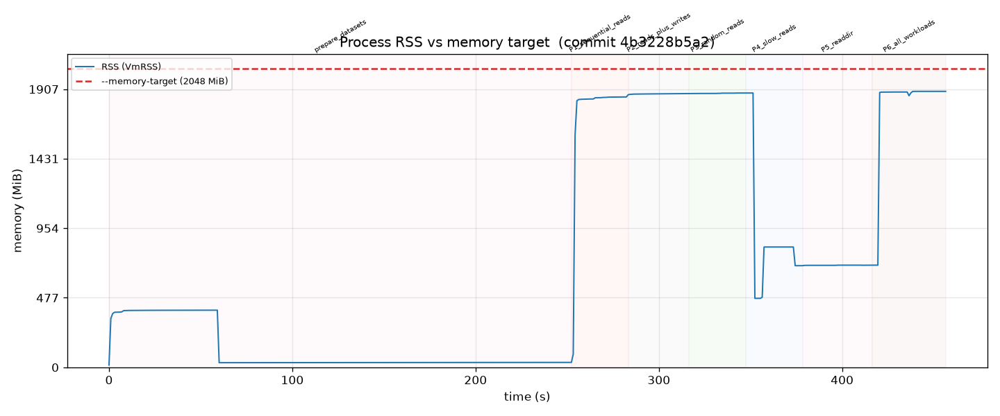
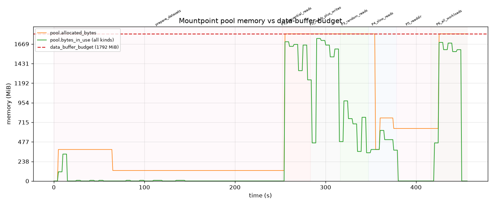

# Memory-limiter stress test report — shakedown

## Summary

With `--memory-target 2048` MiB, over a 8-minute mixed-workload run, the process RSS **HELD** the target: peak RSS was **1892 MiB** (92% of target). Pool `bytes_in_use` peaked at **1736 MiB** vs the data-buffer budget of 1792 MiB (within budget).

## Configuration

- Commit: `4b3228b5a2f2e8f6f1f442d3fe9bc24ca1979b70`
- Host: `ip-172-31-77-58.ec2.internal` (64 cores)
- `--memory-target`: 2048 MiB
- Derived data-buffer budget: 1792 MiB (`mem_limit - max(mem_limit/8, 128 MiB)`)
- Read part size: 8388608; write part size: 8388608
- Max threads: 16
- Mount command: `/home/ec2-user/memlimit-test/mountpoint-s3/target/release/mount-s3 adpeace-mountpoint-perf-test /home/ec2-user/memlimit-test/mountpoint-s3/memory-stress/runs/20260805T172031Z-shakedown-2048MiB/mnt --prefix memlimit-test/ --memory-target 2048 --read-part-size 8388608 --write-part-size 8388608 --max-threads 16 --allow-overwrite --allow-delete --log-metrics --log-directory /home/ec2-user/memlimit-test/mountpoint-s3/memory-stress/runs/20260805T172031Z-shakedown-2048MiB/mp_logs`

## Workload

Read pool: 16 objects x 512 MiB = 8 GiB total. readdir tree: 20 dirs x 50 files. Each phase ran for 30s.

| Phase | Workload | Concurrency |
|---|---|---|
| P1 | sequential reads | 16 readers |
| P2 | sequential reads + writers | 16 readers + 8 writers |
| P3 | random reads | 16 readers |
| P4 | slow (rate-limited) reads | 16 readers @ 1m |
| P5 | readdir + stat loop | 1 recursive lister |
| P6 | all at once | 16+16 readers + 8 writers + readdir |

## Results

### RSS vs memory target



### Pool memory vs data-buffer budget



### Peak memory by phase

| Phase | Peak RSS | Peak pool in-use |
|---|---|---|
| P1_sequential_reads | 1854 MiB | 1696 MiB |
| P2_reads_plus_writes | 1877 MiB | 1736 MiB |
| P3_random_reads | 1881 MiB | 976 MiB |
| P4_slow_reads | 1881 MiB | 616 MiB |
| P5_readdir | 700 MiB | 376 MiB |
| P6_all_workloads | 1892 MiB | 1688 MiB |
| **overall** | **1892 MiB** | **1736 MiB** |

## Findings

- RSS stayed under `--memory-target` throughout: peak 1892 MiB <= 2048 MiB. The limiter held under this workload.
- Pool-tracked memory stayed within the data-buffer budget (in-use peak 1736 MiB, allocated peak 1792 MiB <= 1792 MiB).
- No stalls or deadlocks were detected (all phases progressed and unmount succeeded).

## Reproduction

This run is reproducible from the config in this directory:

```
./run.sh config.env shakedown
```

against commit `4b3228b5a2f2e8f6f1f442d3fe9bc24ca1979b70`. The exact mount command and all
workload parameters are recorded in `run_meta.json` alongside this report.

