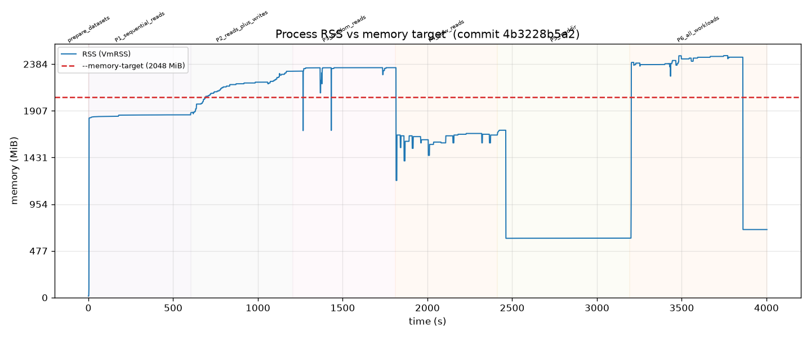
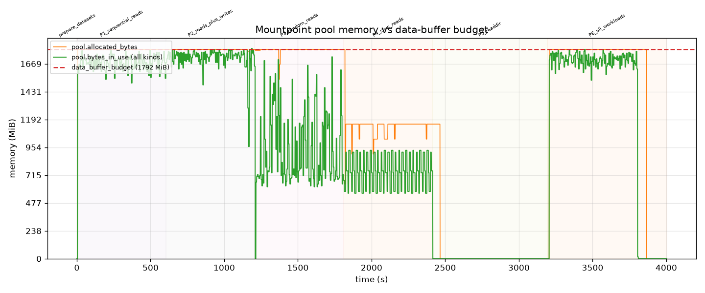

# Memory-limiter stress test report — full

## Summary

With `--memory-target 2048` MiB, over a 67-minute mixed-workload run, the process RSS **EXCEEDED** the target: peak RSS was **2471 MiB** (121% of target). Pool `bytes_in_use` peaked at **1800 MiB** vs the data-buffer budget of 1792 MiB (OVER BUDGET).

## Configuration

- Commit: `4b3228b5a2f2e8f6f1f442d3fe9bc24ca1979b70`
- Host: `ip-172-31-77-58.ec2.internal` (64 cores)
- `--memory-target`: 2048 MiB
- Derived data-buffer budget: 1792 MiB (`mem_limit - max(mem_limit/8, 128 MiB)`)
- Read part size: 8388608; write part size: 8388608
- Max threads: 16
- Mount command: `/home/ec2-user/memlimit-test/mountpoint-s3/target/release/mount-s3 adpeace-mountpoint-perf-test /home/ec2-user/memlimit-test/mountpoint-s3/memory-stress/runs/20260805T175535Z-full-2048MiB/mnt --prefix memlimit-test/ --memory-target 2048 --read-part-size 8388608 --write-part-size 8388608 --max-threads 16 --allow-overwrite --allow-delete --log-metrics --log-directory /home/ec2-user/memlimit-test/mountpoint-s3/memory-stress/runs/20260805T175535Z-full-2048MiB/mp_logs`

## Workload

Read pool: 32 objects x 1024 MiB = 32 GiB total. readdir tree: 200 dirs x 200 files. Each phase ran for 600s.

| Phase | Workload | Concurrency |
|---|---|---|
| P1 | sequential reads | 24 readers |
| P2 | sequential reads + writers | 24 readers + 16 writers |
| P3 | random reads | 32 readers |
| P4 | slow (rate-limited) reads | 24 readers @ 1m |
| P5 | readdir + stat loop | 1 recursive lister |
| P6 | all at once | 24+32 readers + 16 writers + readdir |

## Results

### RSS vs memory target



### Pool memory vs data-buffer budget



### Peak memory by phase

| Phase | Peak RSS | Peak pool in-use |
|---|---|---|
| P1_sequential_reads | 1866 MiB | 1784 MiB |
| P2_reads_plus_writes | 2312 MiB | 1800 MiB |
| P3_random_reads | 2348 MiB | 1728 MiB |
| P4_slow_reads | 2348 MiB | 928 MiB |
| P5_readdir | 1709 MiB | 752 MiB |
| P6_all_workloads | 2471 MiB | 1792 MiB |
| **overall** | **2471 MiB** | **1800 MiB** |

## Findings

- **RSS exceeded `--memory-target`.** Peak 2471 MiB > 2048 MiB (121%). Breach occurred during phase(s): P2_reads_plus_writes, P3_random_reads, P4_slow_reads, P6_all_workloads.
- **Pool-tracked memory exceeded the data-buffer budget** (in-use peak 1800 MiB, allocated peak 1792 MiB vs 1792 MiB). This indicates the pool accounting itself let allocations past the budget.
- No stalls or deadlocks were detected (all phases progressed and unmount succeeded).

## Reproduction

This run is reproducible from the config in this directory:

```
./run.sh config.env full
```

against commit `4b3228b5a2f2e8f6f1f442d3fe9bc24ca1979b70`. The exact mount command and all
workload parameters are recorded in `run_meta.json` alongside this report.

